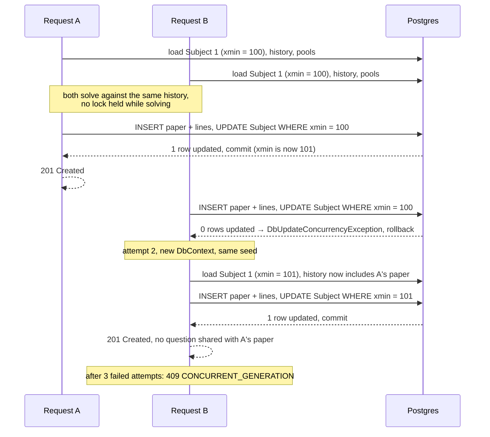
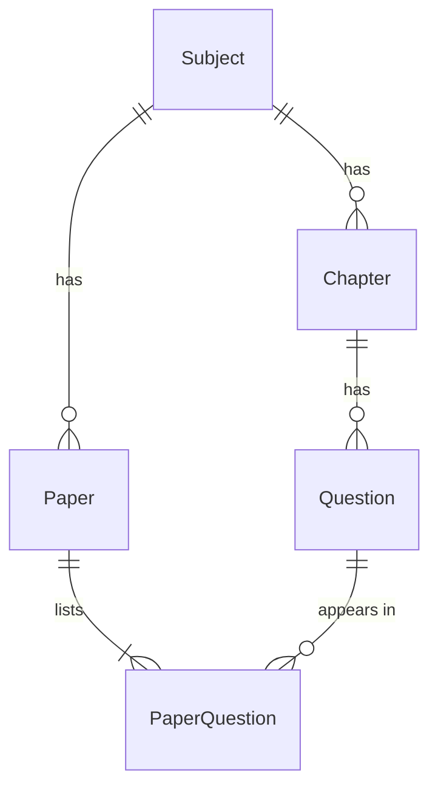

# Architecture

How ExamForge is put together and why. The [README](README.md) covers what it does
and how to run it; [docs/SPEC.md](docs/SPEC.md) is the design it was built to.

## Layout and dependency direction

```text
src/ExamForge.Domain/          entities, enums, result types, service interfaces,
                               and the solver (Generation/): no packages at all
src/ExamForge.Infrastructure/  EF Core DbContext, configurations, migrations,
                               the services that implement the Domain interfaces,
                               the seeder
src/ExamForge.Api/             controllers, request/response DTOs, validators,
                               DI wiring, the --seed switch, OpenAPI + Swagger UI
tests/ExamForge.Tests/         xUnit: unit, integration (Testcontainers), HTTP
seed/questions.json            72 original O Level Physics questions
```

```text
Api ──► Infrastructure ──► Domain
 └──────────────────────────►┘
```

Domain depends on nothing, not even EF Core, so the solver can be tested with plain
in-memory lists. Infrastructure implements the interfaces Domain declares
(`IPaperGenerationService`, `IPaperReadService`, the catalog services). Api only
validates, calls a service and maps the result to a status code: no `DbContext` and no
generation logic in a controller. Entities never cross the API boundary; DTOs do.

Services return closed result types instead of throwing for expected outcomes.
`GenerationResult` is one of `Success`, `Infeasible`, `SubjectNotFound`,
`ChaptersNotInSubject` or `Conflict`, and the controller's `switch` over it is the only
place status codes for generation are decided.

## The generation pipeline

`POST /api/papers/generate` runs four stages. Everything except the solve is in
`PaperGenerationService` (Infrastructure); the solve is `PaperSolver` (Domain).

1. **Validate (Api).** Shape rules only, before any database access: a title, positive
   marks that sum to `totalMarks`, no duplicate chapter, difficulty shares in [0, 1]
   summing to 1, `excludeLastNPapers` present and ≥ 0, a seed within ±(2^53 − 1).
   Failures are a `400` `ValidationProblemDetails` keyed by the JSON path of each field.
2. **Load.** Resolve the seed (the request's, or a fresh one from `ISeedSource`, the
   only unseeded randomness in the process). Load the `Subject` *tracked*, because its
   `xmin` version is what the final save is checked against. Then the requested chapters
   (any not in the subject → `400`), the question ids used in the subject's last N
   papers, and the chapters' active questions. Every query has an `ORDER BY`.
3. **Solve.** `PaperSolver.Solve` gets the pools minus the history, the per-chapter
   targets, the difficulty mix and a `SplitMix64Random` built from the seed. It returns
   a selection or a list of failures.
4. **Verify and persist.** The solver checks its own output (each chapter exact, the
   total exact, `OrderIndex` 1..n), and the service checks the total once more before
   saving: a mismatch throws, so it can only ever be a `500`, never a short paper. Then
   one `SaveChanges` (one transaction) inserts the `Paper` and its `PaperQuestion` rows
   and updates `Subject.LastGeneratedAt`, which fires the concurrency check.

A `DbUpdateConcurrencyException` restarts the whole attempt from stage 2 with a new
`DbContext`, up to 3 attempts in total, and then becomes `409 CONCURRENT_GENERATION`.

## The solver in plain words

Chapters are independent for the hard rules: each chapter's marks must hit its target
exactly, and chapters never compete for questions. Only the soft difficulty mix looks
across chapters.

1. **Can it be done at all?** For each chapter, add up the eligible marks. Fewer than
   requested is a `chapterDistribution` failure. Otherwise a subset-sum table (dynamic
   programming over the marks) says exactly whether some combination hits the target;
   if none does, that is an `exactMarks` failure. Every chapter is checked before
   anything is reported, so one `422` lists all of them.
2. **Find candidates.** For each chapter, in syllabus order: sort the pool by question
   id (so the caller's order never matters), shuffle it with the seeded generator, then
   walk it depth-first, taking or skipping each question. A suffix version of the
   subset-sum table says, at every step, whether the remaining questions can still make
   the remaining marks, so the walk never enters a dead end. It stops after 64 exact
   combinations.
3. **Pick one.** Of those candidates, keep the one that brings the paper's running
   difficulty mix (marks-weighted, this chapter plus the chapters already chosen)
   closest to the requested mix, by L1 distance. Ties go to the first found. That is how
   a later chapter can make up for an earlier one.
4. **Order.** By chapter order, then Easy → Medium → Hard, then question id, so a paper
   opens with easier questions and the order has no ties.

Determinism follows from the pieces: the same pool in the same order, the same seed and
the same generator give the same shuffle, the same walk and the same pick.

## Two generations at once

Two requests for subject 1 load the same history. Without protection both could pick
the same questions and both papers would be saved, each ignoring the other. The
`Subject` row is the lock that is never held: every generation writes to it, and EF Core
adds `WHERE xmin = <version read>` to that write.



The scope is one subject: generations for different subjects update different rows and
never retry each other. `PATCH /api/questions/{id}` joins in: an edit to anything but
`isActive` loads the question's subject (or both subjects, on a chapter move) *before*
checking whether the question is in a paper, and writes that row back unchanged, which
still gives it a new `xmin`. So either the usage check sees a paper that was just
committed, or one of the two saves fails and retries; an edit can never land in a
question at the moment a paper starts using it.

## Data model



- **Subject**: `Name`, `Level`, `LastGeneratedAt`, and `Version`, a `uint` mapped to
  Postgres's `xmin` system column as the concurrency token (no column of its own).
- **Chapter**: `SubjectId`, `Name`, `OrderIndex`, unique per subject.
- **Question**: `ChapterId`, `Text`, `Marks` (check: > 0), `Difficulty` and `Type`
  stored as text with check constraints, `IsActive`, `CreatedAt`.
- **Paper**: `SubjectId`, `Title`, `TotalMarks`, `Seed` (always set), `SpecJson` (the
  specification with the seed used, in a `json` column), `CreatedAt`. Index
  `(SubjectId, CreatedAt DESC, Id DESC)` serves the history query.
- **PaperQuestion**: `PaperId`, `QuestionId`, `OrderIndex`; unique `(PaperId,
  QuestionId)` and `(PaperId, OrderIndex)`.

Deleting a paper cascades to its lines. Everything else is `RESTRICT`: a question in any
paper cannot be deleted, at the API (`409 QUESTION_IN_USE`) and in the database, which
backs the check up if a paper commits between the check and the `DELETE`. Used
questions are frozen except `IsActive`, so a stored paper always shows what was set.

## Testing strategy

235 tests, all passing; one `dotnet test` run takes under 30 seconds on the development
machine (15–23 s across the runs behind this document).

| Folder | Tests | What it covers |
|---|---:|---|
| `Generation/` | 75 | solver, feasibility, ordering, SplitMix64, seed range; pure, no database |
| `GenerationService/` | 21 | the service on Postgres: success, failures, history, determinism, races |
| `Persistence/` | 21 | mapping, constraints, indexes, the `xmin` token, delete rules |
| `Api/` | 96 | every endpoint over HTTP: validation, status codes, bodies, OpenAPI |
| `Catalog/` | 4 | `PATCH` racing a generation, both orders, and the retry limit |
| `Seeding/` | 15 | seed file rules, the seeder, what the seed bank can sustain |
| `EndToEnd/` | 3 | property, determinism and concurrency tests over HTTP on the seed bank |

The races are made deterministic where they can be: the service tests hold two
requests at `SaveChanges` with a gate so both have read the same history before either
commits, then assert that exactly one retry happened, 20 rounds over.

**Tests first.** Every generator behaviour was written as a failing test before the
code, and the red run was looked at to check it failed for the right reason.

**Independent oracles.** A test that reuses the code it checks proves nothing, so the
judges are written separately:

- Feasibility is checked against brute force: plain enumeration of all 2^n subsets, on
  600 random pools for the checker and on every target of 200 random pools for the
  subset-sum table, with no shared code.
- The HTTP property tests read the history with hand-written SQL, not the service's
  LINQ query.
- `SplitMix64` is pinned to a hard-coded golden sequence for seeds 42 and 0.

**Property tests.** Hundreds of random but reproducible specifications per run, each
response checked against rules that must always hold:

- **Solver, in memory.** 500 random feasible specifications: every chapter hits its
  target exactly. 300 random infeasible ones: never a selection. 500 more: the paper is
  exact and correctly ordered.
- **Over HTTP, on the real seed bank.** 300 random requests across two copies of the
  bank (two subjects, so a history query that forgot its subject filter would show).
  In the run behind this document: 165 × `201` and 135 × `422`. Every `201` was checked
  for the exact total and per-chapter marks, ordering, duplicates, history reuse and
  inactive questions; every chapter of every `422` was checked against the brute-force
  oracle (224 `chapterDistribution` and 41 `exactMarks` failures, none of them false).
- **Determinism over HTTP.** 20 papers replayed with the seed they reported: 0
  mismatches.
- **Concurrency over HTTP.** 50 identical requests in 5 bursts of 10: 16 × `201`,
  34 × `409`, nothing else, and no stored paper shares a question with the one before.

Requests without a seed get one from the server, so the exact counts vary a little
from run to run; the properties may not.

**Mutation checks.** A test suite is only trusted once it has been seen to fail. For
this document, seven deliberate bugs were put in one at a time, the full suite was run,
and the code was restored:

| Deliberate bug | Tests failing (of 235) |
|---|---:|
| Generation no longer updates the `Subject` row, so the token never fires | 7 |
| The history window is ignored | 10 |
| History takes the *oldest* N papers instead of the newest | 4 |
| The `exactMarks` check is removed | 9 |
| The pool is not sorted by id before the shuffle | 1 |
| The solver drops one question from every combination | 47 |
| `PATCH` no longer touches the `Subject` row | 3 |

The weakest result is the unsorted pool: one solver test catches it, because every
query that feeds the solver already sorts by id, so the solver's own sort is a second
line of defence. The dropped question fails 47 tests and returns a short paper in none
of them: the verification steps throw first.

**Real Postgres only.** Integration tests run against a `postgres:18` container started
by Testcontainers, never the EF InMemory provider: ordering, `xmin`, check constraints
and `RESTRICT` are exactly what InMemory would hide.
