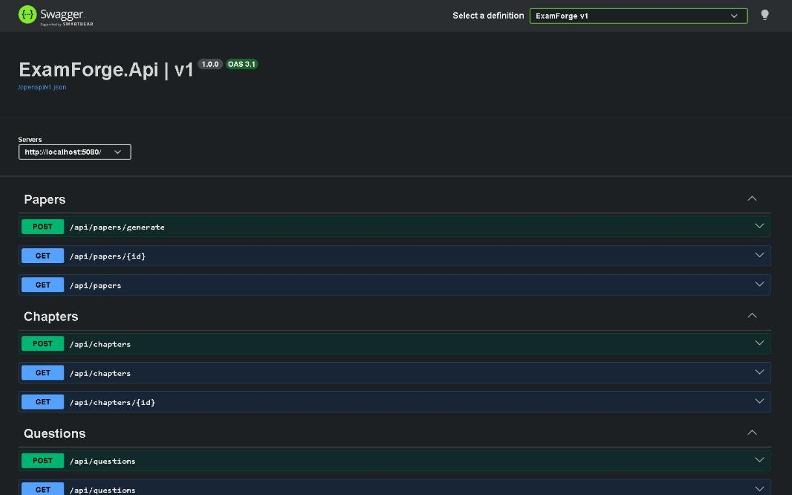
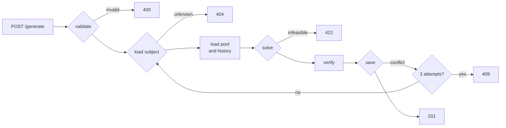
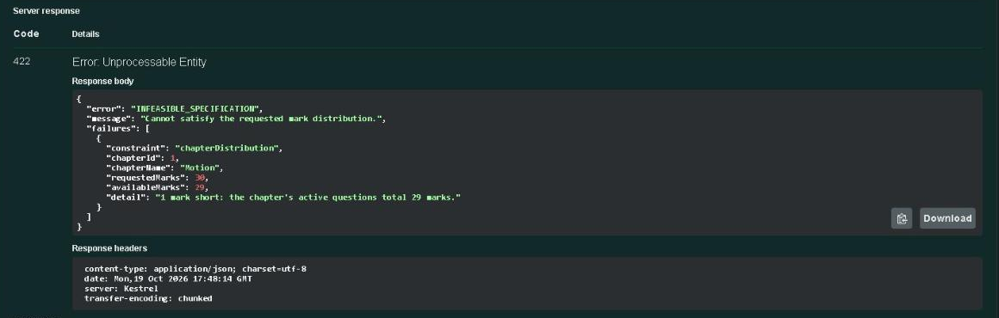

# ExamForge

An ASP.NET Core 10 API that builds exam practice papers from a question bank. You ask
for a total, a mark split across chapters, a difficulty mix and a history window; it
returns a paper whose marks add up **exactly**, with no question from the last N papers,
and the same seed gives the same paper again. When the bank cannot do that, it answers
`422` and names every chapter that falls short. It never returns a short paper.





## Why

I tutor O Level students and set their practice papers by hand. Hand-built papers go
wrong in three ways: the marks drift (a "50-mark" paper comes out at 47 or 53), the same
few chapters get tested every week, and questions come back while students still
remember them. ExamForge fixes those three things and nothing else: no auth, no
frontend, no export ([docs/PRD.md](docs/PRD.md) has the full problem and scope).

## Quickstart

You need Docker Desktop (running) and the .NET 10 SDK, 10.0.402 or later. Nothing else:
the database, schema and seed questions all come from the repo.

```sh
git clone https://github.com/SahadatIslamAsif/ExamForge.git
cd ExamForge
cp .env.example .env            # PowerShell: Copy-Item .env.example .env
docker compose up -d --wait     # Postgres 18 on 127.0.0.1:5432, waits until healthy
dotnet run --project src/ExamForge.Api -- --seed
dotnet run --project src/ExamForge.Api
```

`--seed` applies the migrations, loads [seed/questions.json](seed/questions.json) and
exits. Run twice, it changes nothing. On a new database it prints:

```text
Applied 1 migration. Seeded 1 subject, 6 chapters and 72 questions.
```

The second `dotnet run` serves the API on <http://localhost:5080>; Swagger UI is at
<http://localhost:5080/swagger>. Stop it with Ctrl+C, and the database with
`docker compose down`. Add `-v` only if you want to delete the data: the volume is
named `examforge-pgdata`, so every clone on one machine shares it.

**About the connection string.** `appsettings.Development.json` contains a connection
string whose password is `change-me`, the placeholder from `.env.example`, so a fresh
clone works without anyone choosing a password. It is only a placeholder: it is read
only in the Development environment, and it reaches only the Compose database, which is
bound to 127.0.0.1. Any real setting wins over it: `dotnet user-secrets set
ConnectionStrings:ExamForge "..."` in `src/ExamForge.Api`, or the environment variable
`ConnectionStrings__ExamForge`. If you change the password or port in `.env`, set one
of those to match. User secrets live in your user profile, not in the repo, so a secret
set for an earlier copy of this project also applies to a fresh clone.

## Generate a paper

On a freshly seeded bank, subject 1 is O Level Physics and chapters 1–6 are Motion,
Forces, Energy and Pressure, Thermal Physics, Waves and Light, and Electricity. This
asks for 6 marks from each of the first two chapters
([docs/examples/generate-paper.json](docs/examples/generate-paper.json)):

```sh
curl -s -X POST http://localhost:5080/api/papers/generate -H "Content-Type: application/json" --data "@docs/examples/generate-paper.json"
```

One line on purpose, so it pastes into any shell. In Windows PowerShell type `curl.exe`,
because `curl` there is an alias for `Invoke-WebRequest`. Or use Swagger UI's "Try it
out", whose example body also works on the seed bank.

`201 Created`, captured from a fresh clone (the question texts are original, written
for this project):

```json
{
  "id": 1,
  "subjectId": 1,
  "title": "Week 6 practice",
  "totalMarks": 12,
  "seed": 20261018,
  "achievedDifficultyMix": {
    "easy": 0.25,
    "medium": 0.5,
    "hard": 0.25
  },
  "questions": [
    {
      "orderIndex": 1,
      "questionId": 5,
      "chapterId": 1,
      "chapterName": "Motion",
      "text": "State the difference between speed and velocity.",
      "marks": 2,
      "difficulty": "Easy"
    },
    {
      "orderIndex": 2,
      "questionId": 3,
      "chapterId": 1,
      "chapterName": "Motion",
      "text": "What does the area under the line of a speed-time graph represent?\nA. acceleration\nB. distance travelled\nC. average speed\nD. time taken",
      "marks": 1,
      "difficulty": "Medium"
    },
    {
      "orderIndex": 3,
      "questionId": 9,
      "chapterId": 1,
      "chapterName": "Motion",
      "text": "A car travels 30 km at a steady 60 km/h and then a further 30 km at a steady 30 km/h. Calculate its average speed for the whole 60 km journey.",
      "marks": 3,
      "difficulty": "Medium"
    },
    {
      "orderIndex": 4,
      "questionId": 13,
      "chapterId": 2,
      "chapterName": "Forces",
      "text": "An astronaut has a mass of 70 kg on Earth. What is her mass on the Moon?\nA. 0 kg\nB. 12 kg\nC. 70 kg\nD. 420 kg",
      "marks": 1,
      "difficulty": "Easy"
    },
    {
      "orderIndex": 5,
      "questionId": 19,
      "chapterId": 2,
      "chapterName": "Forces",
      "text": "A spring obeys Hooke's law. A load of 4.0 N stretches it by 2.5 cm. Calculate the extension produced by a load of 6.0 N, assuming the limit of proportionality is not exceeded.",
      "marks": 2,
      "difficulty": "Medium"
    },
    {
      "orderIndex": 6,
      "questionId": 22,
      "chapterId": 2,
      "chapterName": "Forces",
      "text": "A crane lifts a crate of mass 600 kg vertically using an upward force of 6600 N. Taking g = 9.8 N/kg, calculate the acceleration of the crate.",
      "marks": 3,
      "difficulty": "Hard"
    }
  ],
  "createdAt": "2026-10-19T08:29:07.257833Z"
}
```

6 + 6 marks, chapters in syllabus order, easier questions first within each chapter.

Run it on your own fresh clone and you get the same questions in the same order; only
`createdAt` differs. The response includes the `seed` it used (it picks one when the
request has none) and the difficulty mix it achieved, because the mix is a preference,
not a guarantee.

## When the bank cannot do it

Right after that paper, ask for 25 marks from each of the same two chapters, again
excluding questions from the last paper
([docs/examples/generate-infeasible.json](docs/examples/generate-infeasible.json)).
Each chapter holds 29 marks and the paper above used 6 of them.
`422 Unprocessable Entity`, captured from the same run:

```json
{
  "error": "INFEASIBLE_SPECIFICATION",
  "message": "Cannot satisfy the requested mark distribution.",
  "failures": [
    {
      "constraint": "chapterDistribution",
      "chapterId": 1,
      "chapterName": "Motion",
      "requestedMarks": 25,
      "availableMarks": 23,
      "detail": "2 marks short after excluding questions used in the last paper."
    },
    {
      "constraint": "chapterDistribution",
      "chapterId": 2,
      "chapterName": "Forces",
      "requestedMarks": 25,
      "availableMarks": 23,
      "detail": "2 marks short after excluding questions used in the last paper."
    }
  ]
}
```

Every unmet chapter is listed, with what was asked, what was available and why. Nothing
is saved. The other constraint, `exactMarks`, covers the subtler case: enough marks in
total, but no combination that adds up to exactly the target (2-, 4- and 6-mark
questions cannot make 9).

The same in Swagger UI on a freshly seeded bank, asking for 30 marks from Motion, which
holds 29 in all:



## Tests

```sh
dotnet test
```

Docker must be running: the integration tests start their own throwaway `postgres:18`
container with Testcontainers and never touch the Compose database. In-memory EF is not
used anywhere, because it hides the ordering and concurrency behaviour that matters here.

235 tests, all passing, in under 30 seconds on my machine:

- **Solver** (75, no database): exact marks across 500 random specifications, an
  infeasible one never returning a selection, ordering, the seeded generator pinned to
  golden values, and feasibility checked against brute-force enumeration.
- **Generation service** (21, Postgres): success, every failure kind, the history
  window, determinism, and races held at the save so the retry path really runs.
- **HTTP API** (96): every endpoint's validation, status codes and bodies, and the
  OpenAPI document.
- **Persistence, catalog races, seeding** (40): constraints, indexes, the `xmin`
  token, `PATCH` racing a generation, the seed bank and what it can sustain.
- **End to end** (3): 300 random requests over HTTP on the real seed bank with
  every answer checked independently, 20 papers replayed from their seed, and 50
  parallel requests.

Seven deliberate bugs were planted one at a time and each one failed the suite; the
details and numbers are in [ARCHITECTURE.md](ARCHITECTURE.md#testing-strategy).

## Design decisions

**Determinism.** All selection randomness comes from one SplitMix64 generator built from
the request's `long` seed, never `System.Random` (whose seeded sequence .NET does not
promise to keep). When the request has no seed, the service picks one before solving,
stores it on the paper and returns it. Seeds stay within ±(2^53 − 1), JavaScript's safe
integer range, so a browser client cannot silently round a seed into a different paper.
Every query that feeds selection has an explicit `ORDER BY`, because Postgres does not
promise a row order.

**Honest failure.** Before solving, a subset-sum check proves for every chapter whether
its target is reachable, and a `422` lists every chapter that is not, not just the
first. After solving, the totals are checked again, in the solver and once more in the
service before saving. If that check ever failed it would be a bug, so it throws (a
`500`) rather than return a short paper.

**History-aware selection.** `excludeLastNPapers` removes every question used in the
subject's last N papers (newest first by `CreatedAt`, then `Id`). It is required: a
client that forgets it should get a `400`, not a silent "no exclusion". `0` turns the
window off.

**Concurrency.** Two simultaneous requests for one subject would read the same history
and could pick the same questions. Each generation therefore updates its `Subject` row,
which carries an EF Core concurrency token mapped to Postgres's `xmin`. If another paper
committed first, the save fails, and the service reloads the history and solves again
(same seed), up to 3 attempts, then answers `409 CONCURRENT_GENERATION`. No lock is held
while solving. Editing a question takes part in the same scheme: a `PATCH` touches the
subject row too, so it cannot slip a change into a question at the moment a paper starts
using it.

**Used questions are frozen.** Once a question is in a paper, only `isActive` can change;
editing its text, marks, difficulty, type or chapter, or deleting it, is a
`409 QUESTION_IN_USE`. Deactivating is the soft delete: the question stops being
selected, and old papers still show exactly what students were given.

**No LLM.** There is deliberately no LLM in the generation path, because exactness and
reproducibility are the requirements.

## Known limits

- **Bank capacity.** A chapter of the seed bank holds 29 marks. With
  `excludeLastNPapers = N`, every N + 1 consecutive papers need different questions, so
  a chapter can supply about 29 / (N + 1) marks per paper in a steady run: about 7 at
  N = 3. Ask for more and the bank runs out, honestly, with a `422`.
- **Heavy parallel load on one subject gets `409`s.** Three attempts are enough for
  normal use, not for bursts: in the test run, 50 requests fired in bursts of 10 got
  16 × `201` and 34 × `409` (and no paper broke its window).
- **Reproducibility is relative to the current bank and history.** Adding questions or
  generating other papers in between can change what a seed produces. The stored paper
  never changes.
- **HTTP only.** The API listens on plain HTTP locally; in a deployment, HTTPS belongs to
  a reverse proxy in front of it.

## Endpoints

```text
POST   /api/papers/generate         GET /api/papers/{id}     GET /api/papers?subjectId=
POST   /api/subjects                GET /api/subjects        GET /api/subjects/{id}
POST   /api/chapters                GET /api/chapters?subjectId=   GET /api/chapters/{id}
POST   /api/questions               GET /api/questions?chapterId=&difficulty=
GET    /api/questions/{id}          PATCH /api/questions/{id}      DELETE /api/questions/{id}
```

Requests and responses are `application/json` only. `400` and `404` are
`application/problem+json`; `409` and `422` carry an `error` code and a `message`
(plus `failures` on a `422`). The codes: `INFEASIBLE_SPECIFICATION`,
`CONCURRENT_GENERATION`, `QUESTION_IN_USE`, `CHAPTER_ORDER_TAKEN`, `CONCURRENT_EDIT`.

## More

- [ARCHITECTURE.md](ARCHITECTURE.md): layout, the generation pipeline, the solver, the
  data model and the testing strategy.
- [docs/PRD.md](docs/PRD.md) and [docs/SPEC.md](docs/SPEC.md): the requirements and the
  technical design this was built to.
